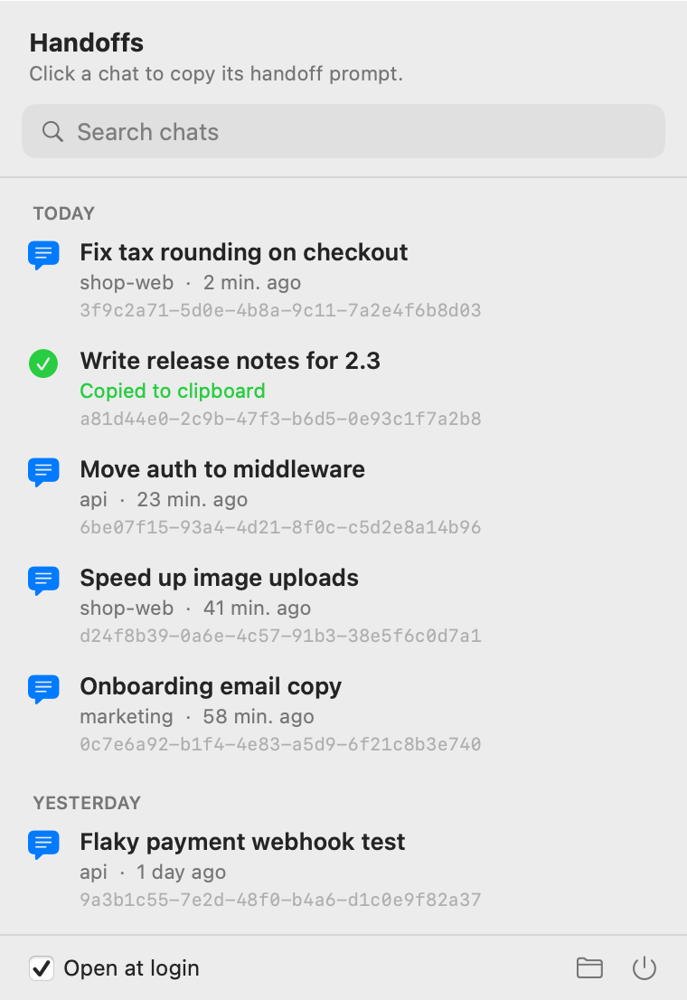
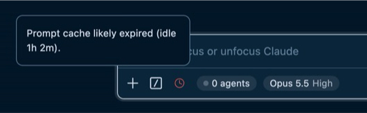
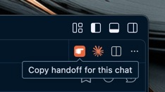

<a href="https://proxylang.dev/?utm_source=handoffbar&utm_medium=github&utm_campaign=getstarted15"></a>

<p align="center"></p>

<h1 align="center">HandoffBar</h1>

<p align="center">Pick up any <a href="https://claude.com/claude-code">Claude Code</a> chat where you left off (without wasting tokens).<br>
캐시가 만료돼도, Claude Code 대화를 토큰 낭비 없이 하던 그대로 이어가세요.<br>
<a href="https://github.com/Proxylang/handoff-bar/releases/latest/download/HandoffBar.dmg"><b>Download for Mac · Mac용 다운로드</b></a> · <a href="https://apps.microsoft.com/detail/9nsk9p03t9cn"><b>Download for Windows · Windows용 다운로드</b></a> · <a href="https://marketplace.visualstudio.com/items?itemName=Proxylang.handoffbar"><b>VS Code extension · VS Code 확장 프로그램</b></a> · <a href="#claude-code-mod--claude-code-모드"><b>Claude Code mod · Claude Code 모드</b></a> · <a href="https://handoffbar.proxylang.dev">Website · 웹사이트</a></p>

<p align="center"><picture>
<source media="(prefers-color-scheme: dark)" srcset="site/panel-dark.png">

</picture></p>

## What it does · 하는 일

Claude Code charges full price to pick a chat back up after a break. HandoffBar gives you a clean and accurate handoff, so you can start a new chat instead.

1. **Saves** a handoff of every chat for you
2. **Copy** it with one click
3. **Paste** it into a new chat and keep going

You can see when a break got expensive. Claude Code shows a red clock in the message box, and hovering it says the cache expired:

<p align="center"></p>

**한국어**

Claude Code는 잠시 쉬었다가 대화를 다시 이어가면 정가를 받아요. HandoffBar는 깔끔하고 정확한 핸드오프를 만들어 주니까, 대신 새 대화를 시작하면 돼요.

1. 모든 대화의 핸드오프를 알아서 **저장**해요
2. 클릭 한 번으로 **복사**해요
3. 새 대화에 **붙여 넣고** 그대로 이어가요

쉬는 동안 비용이 커졌는지는 바로 보여요. Claude Code 입력창에 빨간 시계 아이콘이 뜨고, 마우스를 올리면 위 그림처럼 캐시가 만료됐다고 알려 줘요.

## Where do you use Claude? · Claude를 어디서 쓰세요?

Three ways to copy a handoff. They all save the same file for each chat, so you can use more than one. None of them types into your chat.

The Claude desktop app can't show buttons from extensions or mods yet. Use the menu bar app there.

**한국어**

핸드오프를 복사하는 방법은 세 가지예요. 셋 다 대화마다 같은 파일을 저장하니까 여러 개를 같이 써도 돼요. 어느 것도 대화창에 글을 입력하지 않아요.

Claude 데스크톱 앱은 아직 확장 프로그램이나 모드의 버튼을 보여 주지 못해요. 데스크톱 앱에서는 메뉴 막대 앱을 쓰세요.

### Menu bar app · 메뉴 막대 앱

In your Mac menu bar or Windows taskbar.

> **Works with** the terminal, VS Code, and the Claude desktop app

Every recent chat in one list. Click a chat and its handoff is on your clipboard. [Install steps](#install--설치).

**한국어**

Mac 메뉴 막대나 Windows 작업 표시줄에 있어요.

> **쓸 수 있는 곳:** 터미널, VS Code, Claude 데스크톱 앱

최근 대화가 한 목록에 모두 보여요. 대화를 누르면 그 대화의 핸드오프가 클립보드에 복사돼요. [설치 방법](#install--설치)을 확인하세요.

### VS Code extension · VS Code 확장 프로그램

On each Claude chat tab.

> **Works with** Claude Code in VS Code

Click the orange hand to copy that chat's handoff. The bar at the bottom of VS Code shows how long its cache has left.

<p align="center"></p>

Install it from the [VS Code Marketplace](https://marketplace.visualstudio.com/items?itemName=Proxylang.handoffbar), or search the Extensions view for **HandoffBar for Claude Code**. Its source is in [vscode/](vscode/).

**한국어**

Claude 대화 탭마다 붙어 있어요.

> **쓸 수 있는 곳:** VS Code의 Claude Code

주황색 손 아이콘을 누르면 그 대화의 핸드오프가 복사돼요. VS Code 맨 아래 막대에는 캐시가 얼마나 남았는지 보여요.

[VS Code Marketplace](https://marketplace.visualstudio.com/items?itemName=Proxylang.handoffbar)에서 설치하거나, 확장 프로그램 보기에서 **HandoffBar for Claude Code**를 검색하세요. 소스 코드는 [vscode/](vscode/) 폴더에 있어요.

### Claude Code mod · Claude Code 모드

Right above your prompt.

> **Works with** Claude Code in the terminal

Press **0** before you type anything to copy the handoff, or click the button in fullscreen mode (`/tui fullscreen`). A countdown shows how long the cache has left. When Claude Code starts, the mod also saves handoffs for your other chats from the past week that don't have an up-to-date one.

Type this at the Claude Code prompt to install it:

```
/plugin install handoffbar --marketplace Proxylang/handoff-bar
```

Its source is in [mod/](mod/). Chats over 4 MB are too big for a mod to read; the menu bar app handles those.

**한국어**

입력창 바로 위에 있어요.

> **쓸 수 있는 곳:** 터미널의 Claude Code

아무것도 입력하기 전에 **0**을 누르면 핸드오프가 복사돼요. 전체 화면 모드(`/tui fullscreen`)에서는 버튼을 클릭해도 돼요. 캐시가 얼마나 남았는지 카운트다운으로 보여 줘요. Claude Code를 시작하면 지난 일주일 동안의 다른 대화 중 최신 핸드오프가 없는 대화도 저장해 줘요.

Claude Code 입력창에 아래 명령을 입력하면 설치돼요.

```
/plugin install handoffbar --marketplace Proxylang/handoff-bar
```

소스 코드는 [mod/](mod/) 폴더에 있어요. 4MB가 넘는 대화는 모드가 읽을 수 없어서 메뉴 막대 앱이 맡아요.

## The details · 자세한 내용

**In every handoff**

- Your first request and your last ten
- The choices you made and Claude's next steps
- Files the chat changed, and anything still running
- The last error and Claude's last reply
- The chat's title, folder, and git branch
- Claude's own summary, if the chat got long enough for Claude Code to write one

**In the app**

- Search every chat by title or project
- Chats grouped by day, under your tab names
- Opens at login and follows light or dark mode
- macOS 13 or later, Windows 10 or later

**Stays on your computer**

- Writes one Markdown file per chat in `~/.claude/handoffs`
- No account, no analytics, no AI model
- Only network use: the Mac app checks GitHub for updates once a day ([Updater.swift](Sources/Updater.swift))
- Signed by Apple and the Microsoft Store, open source under MIT

**한국어**

**핸드오프에 담기는 내용**

- 첫 요청과 최근 요청 10개
- 내가 고른 선택과 Claude가 정리한 다음 할 일
- 그 대화에서 바꾼 파일과 아직 실행 중인 명령
- 마지막 오류와 Claude의 마지막 답변
- 대화 제목, 폴더, git 브랜치
- 대화가 길어져 Claude Code가 요약을 만들었다면, 그 요약

**앱 기능**

- 제목이나 프로젝트로 모든 대화 검색
- 날짜별로 묶고, 내가 붙인 탭 이름으로 표시
- 로그인 시 자동 실행, 라이트·다크 모드 자동 전환
- macOS 13 이상, Windows 10 이상

**내 컴퓨터 안에서만**

- `~/.claude/handoffs`에 대화마다 Markdown 파일 하나만 만들어요
- 계정, 분석 도구, AI 모델 모두 없어요
- 네트워크 사용은 하나뿐이에요: Mac 앱이 하루에 한 번 GitHub에서 업데이트를 확인해요([Updater.swift](Sources/Updater.swift))
- Apple과 Microsoft Store의 서명을 받았고, MIT 라이선스 오픈 소스예요

## When handoffs are written · 핸드오프 저장 시점

Each Claude Code chat gets a cache that lasts either 5 minutes or 1 hour. The menu bar app checks your chat files in `~/.claude/projects/` once a minute and reads which cache each chat got from the usage data Claude Code saves. Then it writes the handoff:

- 3 minutes after the last reply, for every chat. That is 2 minutes before a 5-minute cache expires.
- Again 5 minutes before a 1-hour cache expires. The chat moves back to the top of the list.

A new reply in that chat resets the timer. Chats started in a temp folder (usually scripts running Claude Code) are skipped. The Claude Code mod saves on the same schedule for the chat it runs in. The VS Code extension writes a chat's handoff when you click the hand.

**한국어**

Claude Code 대화의 캐시는 5분 또는 1시간 동안 유지돼요. 메뉴 막대 앱은 1분마다 `~/.claude/projects/` 폴더의 대화 파일을 살펴보고, Claude Code가 기록해 둔 사용량 데이터로 대화별 캐시 길이를 확인해요. 그리고 아래 시점에 핸드오프를 저장해요.

- 모든 대화: 마지막 답변 3분 후. 5분 캐시라면 만료 2분 전이에요.
- 1시간 캐시: 만료 5분 전에 한 번 더 저장해요. 그 대화가 목록 맨 위로 다시 올라와요.

그 대화에 새 답변이 오면 타이머는 처음부터 다시 시작돼요. 임시 폴더에서 시작된 대화(대개 스크립트가 Claude Code를 실행한 경우)는 건너뛰어요. Claude Code 모드는 자기가 실행 중인 대화를 같은 시점에 저장해요. VS Code 확장 프로그램은 손 아이콘을 누를 때 그 대화의 핸드오프를 저장해요.

## Install · 설치

1. Download [HandoffBar.dmg](https://github.com/Proxylang/handoff-bar/releases/latest/download/HandoffBar.dmg).
2. Open it and drag HandoffBar into Applications.
3. Open HandoffBar, click the hand in your menu bar, and tick **Open at login**.

Needs macOS 13 or later. Works on Apple Silicon and Intel. The app is signed and notarized by Apple.

If you use a menu bar manager such as Ice or Bartender, it may hide the new icon. Drag it into the visible part of the menu bar.

**Windows:** get HandoffBar from the [Microsoft Store](https://apps.microsoft.com/detail/9nsk9p03t9cn). It needs Windows 10 (version 1809) or later. The hand sits in the taskbar corner; if Windows hides it, drag it out of the ^ overflow menu. The Store signs and updates it. Its source is in [windows/](windows/).

**한국어**

1. [HandoffBar.dmg](https://github.com/Proxylang/handoff-bar/releases/latest/download/HandoffBar.dmg)를 내려받아요.
2. 파일을 열고 HandoffBar를 응용 프로그램 폴더로 끌어다 놓아요.
3. HandoffBar를 실행한 뒤 메뉴 막대의 손 아이콘을 누르고 **Open at login**에 체크해요.

macOS 13 이상에서 동작하고, Apple Silicon과 Intel Mac을 모두 지원해요. Apple의 서명과 공증을 받은 앱이라 경고 없이 바로 열려요.

Ice나 Bartender 같은 메뉴 막대 정리 앱을 쓰고 있다면 새 아이콘이 숨겨질 수 있어요. 그럴 땐 아이콘을 메뉴 막대의 보이는 영역으로 끌어다 놓으세요.

**Windows:** [Microsoft Store](https://apps.microsoft.com/detail/9nsk9p03t9cn)에서 HandoffBar를 받으세요. Windows 10(버전 1809) 이상에서 동작해요. 손 아이콘은 작업 표시줄 오른쪽 구석에 있어요. 보이지 않으면 ^ 메뉴에서 꺼내 작업 표시줄로 끌어다 놓으세요. 서명과 업데이트는 Microsoft Store가 맡아요. 소스 코드는 [windows/](windows/) 폴더에 있어요.

## Build from source · 소스에서 빌드

```
./build.sh
```

This builds the Mac app, signs it, copies it to `~/Applications`, and starts it. It needs Apple's command line tools (`xcode-select --install`). Without a Developer ID certificate the app is signed for your Mac only.

To make a notarized download, store a notarytool keychain profile first, then run:

```
./build.sh release <profile name>
```

The installer lands in `dist/HandoffBar.dmg`, with a zip of the app next to it.

To redraw the app icon:

```
swift tools/make-icon.swift
iconutil -c icns AppIcon.iconset -o AppIcon.icns
```

The VS Code extension builds with `vscode/build.sh` (after `npm install` in `vscode/`) into `vscode/dist/handoffbar-<version>.vsix`. The Claude Code mod needs no build: `claude --plugin-dir mod` runs it from the folder, and `claude plugin test mod` runs its tests.

The website is the static `site/` folder.

**한국어**

`./build.sh`를 실행하면 Mac 앱을 빌드하고 서명한 다음, `~/Applications`에 복사해서 실행해요. Apple 명령줄 도구가 필요해요(`xcode-select --install`). Developer ID 인증서가 없으면 빌드한 Mac에서만 실행되도록 서명돼요.

공증된 설치 파일을 만들려면 먼저 notarytool 키체인 프로필을 저장한 다음 `./build.sh release <프로필 이름>`을 실행하세요. 설치 파일은 `dist/HandoffBar.dmg`에, 앱 zip 파일은 그 옆에 만들어져요.

앱 아이콘은 위의 두 명령으로 다시 만들 수 있어요.

VS Code 확장 프로그램은 `vscode/` 폴더에서 `npm install`을 한 뒤 `vscode/build.sh`로 빌드하면 `vscode/dist/handoffbar-<버전>.vsix`가 만들어져요. Claude Code 모드는 빌드가 필요 없어요. `claude --plugin-dir mod`로 폴더에서 바로 실행하고, `claude plugin test mod`로 테스트해요.

웹사이트는 `site/` 폴더에 있는 정적 파일이에요.

## Made by Proxylang · 만든 곳

HandoffBar is made by [Proxylang](https://proxylang.dev). Proxylang translates websites into 77+ languages. Add one line of code and your site is live in other languages in about a minute, with per-language SEO built in.

HandoffBar is not affiliated with Anthropic. MIT licensed. [Privacy policy](https://handoffbar.proxylang.dev/privacy.html).

**한국어**

HandoffBar는 [Proxylang](https://proxylang.dev)이 만들었어요. Proxylang은 웹사이트를 77개 이상의 언어로 번역해 주는 서비스예요. 코드 한 줄만 추가하면 1분 정도 만에 사이트가 여러 언어로 열리고, 언어별 SEO도 기본으로 지원해요.

HandoffBar는 Anthropic과 관련이 없어요. MIT 라이선스로 배포해요. [개인정보 처리방침](https://handoffbar.proxylang.dev/privacy.html).
